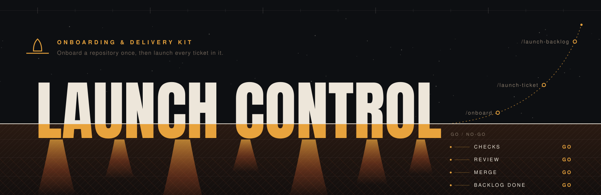

<p align="center">
  
</p>

# Launch Control

Launch Control is a Claude Code-first onboarding and delivery kit. Its `/onboard` command
scans a new project and equips it with accurate guidance, validation-aware commands,
specialist agents, and a complete document-driven delivery workflow. It turns the
repository into a ready-to-ship Claude workspace where `/launch-ticket` and Superpowers can carry
work from idea through researched, tested, reviewed delivery, one ticket at a time or as a
`/launch-backlog` over a BACKLOG section.

The installer supports Claude Code and native Codex core skills and agents. Both use
the shared discovery model; project generation retains each host’s runtime boundaries.

> Generated output reflects whatever is actually in the target repo — nothing is
> assumed. Ticket/URL examples in this README use neutral placeholders
> (`PROJ-123`, `your-org.atlassian.net`, `acme`). Optional delivery hooks
> (`ship`, `security-review`, `deploy-verify`) are opt-in via
> `.claude/onboard-config.json` — see the onboard skill's `launch-discovery.md`
> — never guessed from filenames.

## Quick start

```bash
git clone https://github.com/rm0nroe/launch-control.git
cd launch-control
./install.sh
```

While this repository is private, cloning requires repository access and authenticated
Git credentials (for example, `gh auth login` followed by `gh auth setup-git`).

Onboarding supports macOS and Linux. Install Bash, Git, `jq`, and your chosen agent
host first. Python 3 powers the HTML report; native Codex requires Python 3.11+ and
uses `./install.sh --codex`.
Claude Code must already be installed for the default install. The default installer
copies Launch Control's skills
and agents, preserves any working Obra or official Superpowers provider, and installs
and verifies the official provider only when none exists. On an upgrade, it automatically
backs up and replaces an untouched copy whose digest matches a released Launch Control
version. If an installed copy is unknown or user-modified, the installer stops before
dependency or file changes and tells you to review it instead of silently leaving stale
code active. Restart Claude Code after installation, then inside a project:

```text
/onboard                           # complete Launch Control workspace (Claude Code, Codex)
/onboard --dry-run                 # complete preview; no writes
/onboard --launch-control          # maintenance: regenerate the delivery skill only
/onboard --enable-mcp              # complete install + relevant project MCP config
/onboard --enable-hooks            # complete install + Launch Control hooks
/onboard --no-worktrees            # render the delivery skill with in-place branches
/onboard --launch-control --include-global-claude  # explicit, narrow user-global guidance opt-in
/launch-ticket PROJ-123                   # deliver one ticket end to end
/launch-backlog stage path/to/project.json  # plan a mission over a BACKLOG section; prints its digest
/launch-backlog go <digest> path/to/project.json  # run it (also resumes a held mission)
/launch-backlog hold path/to/project.json   # stop at the next safe point
/offboard                      # preview removing the generated workspace; --apply removes it
```

`--launch-control` cannot be combined with `--enable-mcp` or `--enable-hooks`; those overlays
require a normal `/onboard` run.

**Onboarding never runs your project's code.** It reads the repository, sets up the agents
around it, and records the gates your project documents (CI, package scripts, README) so those
agents know them. It does not test, build, lint or format anything, and it never asks you to
change how your project runs its tests. When something looks off, such as a gate it did not
record or a stale generated block, the report says so as a note for you and nothing fails or
blocks.

`/onboard` creates `CLAUDE.md` when absent and updates only a marked generated section
when it already exists. Native `/init` remains available as Claude's lightweight
guidance generator, but Launch Control does not require it.

Optional supporting CLIs:

```bash
./install.sh --optional-tools   # installs gh when missing
```

Current skills and agents are idempotently skipped. Untouched older Launch Control versions
are upgraded automatically with timestamped backups under
`~/.claude/launch-control-backups/<timestamp>/`, outside active skill and agent discovery.
A successful install whose backup holds only released copies keeps that backup and removes
the previous one, so one version back is kept. A backup holding user content (a `--force`
replacement of a modified copy or a quarantined `.bak-*`) or left by a failed install is never removed automatically.
Unknown or user-modified differing copies stop the entire install before any dependency
or file mutation. Review those paths first; use `--force` only when you explicitly intend
to back them up and replace them. Normal installs also move older Launch Control-owned
`.bak-*` copies out of discovery into that backup root. On upgrades, renamed Launch Control
skills and their old-name backups are moved to
`~/.claude/launch-control-legacy-skills/<timestamp>/`. Move preserved content back to roll
back. Run `./install.sh --dry-run` to preview installation and both quarantine paths.

To retain a named colliding provider, create the local regular file
`~/.claude/launch-control-user-owned.txt` with one exact `skills NAME` or `agents NAME.md`
line per existing source path, for example `skills research`. The installer leaves each
declared directory and its `.bak-*` copies untouched, even with `--force` or
`--uninstall`; it reports a partial install and `./tools/preflight-onboard.sh` continues
to fail if the retained path differs from Launch Control source. Declarations never add an
ownership digest or silently make a foreign provider current.

To remove Launch Control from active Claude discovery without touching Superpowers or
unrelated tools, preview the ownership scope first:

```bash
./install.sh --uninstall --dry-run
./install.sh --uninstall
```

Uninstall removes only copies whose digest matches the released ownership manifest. It
stops before mutation on an unknown or user-modified manifest-named path. Use
`--uninstall --force` only when you intend to move such a path to
`~/.claude/launch-control-uninstall-backups/<timestamp>/` rather than delete it.

When developing Launch Control itself, run this before launching Claude Code for a manual
`/onboard` acceptance test:

```bash
./tools/preflight-onboard.sh
```

It fails fast on any source/install mismatch and prints the exact `./install.sh --force`
refresh command. After a passing preflight,
fully restart Claude Code, open an ordinary session in this checkout, and run plain
`/onboard`. Do not use a copied skill, alternate configuration root, temporary checkout,
or settings-source override. Do not turn a mismatch, dirty worktree, or self-dogfood run
into a run-mode question inside `/onboard`.

To package the tracked, ignore-respecting source for a release:

```bash
git archive --format=zip --prefix=launch-control/ --output=launch-control.zip HEAD
```

## Validate Launch Control changes

The repository's declared validation contract is exactly:

```bash
./tools/validate-pack.sh
./install.sh --dry-run
```

Do not infer additional required gates from installed tools or file types.

## One complete onboarding path

A normal `/onboard` run generates project guidance, narrow settings, core project-local
skills, agents and commands, the delivery skill, worktree-aware delivery, architecture and
infrastructure documentation, the complete delivery chain, self-validation, and a
deterministic completion ledger. There is no setup-level choice to make.

Generated `.claude/` output is project-local and may be intentionally gitignored by a
target repository. Review it with an ignore-aware command such as
`git status --short --ignored .claude/` or direct file inspection; normal Git status
may not display it.

Generated settings pre-authorize exact detected checks and read-only inspection only.
They do not grant arbitrary interpreter wildcards, unrestricted Git/GitHub access, or
mutating repository commands.

Use `/onboard --launch-control` only to maintain an existing project-specific delivery skill.
MCP configuration, hooks, push, PR/MR creation, and other external writes require
explicit opt-in or confirmation.

The delivery skill is generated as `.claude/skills/launch/` (`.codex/skills/launch/` in Codex).
A repository onboarded before that has it at `skills/send-it/`; the next `/onboard` or
`/onboard --launch-control` regenerates it as `launch`, keeps your own edits, and parks the
old copy under `.launch-control/refresh/retired/`. An old copy with uncommitted changes stays
where it is and the report says so: compare it with `launch`, then remove it yourself.

After upgrading from the former one-file delivery skill format, run `/onboard --launch-control` to
generate its four scoped references. Until regenerated, workspace validation reports those
references as missing. The generated verification reference retains every project-supported
platform, while each ticket run reads and executes only its selected platform subsection plus
relevant rendered cross-cutting capability sections. Shared tickets also name and run only
their affected consuming platforms.

Every writing onboarding mode preflights Superpowers before writing project files. If it
is missing, onboarding stops with installation instructions; `/onboard` itself does not
mutate user-global plugin state. `./install.sh` owns dependency provisioning.

## Core concepts

| Concept | Meaning |
|---|---|
| **Launch Control** | The complete onboarding and delivery kit: global skills and agents plus the project-local workspace they generate. |
| **Guide Stars** | Sourced, dated domain facts in `guide-stars/`, written by `catalog`, that are stable enough to guide work across tickets. |
| **Workbench** | Ticket-specific research, designs, outlines, plans, reviews, and decisions under `workbench/<TICKET>/<stage>/`. Workflow skills create these artifacts after onboarding. |
| **Artifacts** | Stable project snapshots such as `artifacts/architecture.md` and `artifacts/infrastructure.md`, created or refreshed from the repository itself. |
| **Onboard** | The discovery and setup command (`/onboard`) that turns an existing repository into a complete Launch Control workspace without replacing user-owned content. |
| **Launch** | The project-specific delivery skill generated by Onboard (`/launch-ticket <ticket>`); it carries an approved ticket through isolated implementation, validation, review, and delivery. |
| **Mission** | A run over one BACKLOG section (`## Mission: <Name>`): `/launch-backlog stage` plans it, `/launch-backlog go` delivers each eligible row as its own reviewed, merged PR. |

## How the workflow fits together

Launch Control combines focused skills into a document-driven path. Each skill handles
one kind of work and can be used independently; together they move from clarifying the
problem to understanding the code, shaping a design, planning the change, and carrying
it through implementation. Each authored stage through planning leaves a reviewable
artifact in `workbench/`; `plan-execute` then executes the approved plan and
verifies the resulting code.

```
research-questions → research-codebase → design-doc → design-outline
   → plan-write → plan-execute
```

Adversarial review (`review-doc`) is a checkpoint between authored stages. Supporting skills
capture decisions (`log-decision`), list them later (`logbook`), and record durable domain
context as guide stars (`catalog`) without requiring the entire sequence. `/launch-ticket`
selects and combines the relevant elements for the project-specific delivery path.

## Contents

### Onboard + delivery
| Skill | Purpose |
|---|---|
| `onboard` | Scan a repo and generate the complete `.claude/` workspace and per-project delivery skill. |
| `launch-ticket` | Deliver one ticket with the repository's delivery skill. |
| `launch-backlog` | Stage, go, hold or check a mission over a BACKLOG section. |
| `offboard` | Remove a generated workspace from a repository. |

### Pipeline skills
| Skill | Purpose |
|---|---|
| `research-questions` | Turn problem intake into neutral, solution-agnostic research questions. |
| `research-codebase` | Document a codebase as-is into `workbench/` for historical context. |
| `design-doc` | Interactive technical design doc from research. |
| `design-outline` | High-level structure outline with vertical phases + test checkpoints. |
| `plan-write` | Detailed tactical implementation plan. |
| `plan-execute` | Execute an approved plan one phase at a time with verification. |
| `review-doc` | Bounded adversarial review of any pipeline document. |
| `log-decision` | Capture an ad-hoc decision as a dated, structured snapshot. |
| `logbook` | List recorded decisions newest first, filtered by ticket, date or keyword. |
| `catalog` | Author a guide star: a sourced, dated, globally-true fact for the team's domain. |

### Docs
| Skill | Purpose |
|---|---|
| `docs-create` | Create architecture/infra/changelog/backlog/CLAUDE.md for a codebase. |
| `docs-update` | Update all project docs to match current code. |

### Shared
- `snippets-shared-by-skills/`: common fragments (`source-fetchers`, `permalinks`,
  `guide-stars-preamble`) referenced by multiple workflow skills. Keep alongside the skills.

### Subagents (`agents/` → `~/.claude/agents/`)
`surveyor`, `navigator`, `veteran` (code discovery),
`technician`, `integrator` (prior-artifact discovery),
`skeptic`, `editor` (used by `review-doc` and the design/plan loops).

## Dependencies installed

- **Plugin (required):** `superpowers` — provides `superpowers:brainstorming`,
  `:test-driven-development`, `:systematic-debugging`, `:verification-before-completion`,
  and `:using-git-worktrees`, which the generated delivery skill invokes.
  Launch Control uses `plan-execute` instead of `superpowers:executing-plans` to
  avoid duplicate execution. Upstream: `github.com/obra/superpowers`;
  available via `anthropics/claude-plugins-official` and provisioned by the default
  installer when needed.
- **CLI (optional):** `gh` (GitHub).
- **MCP (optional):** `github` and `atlassian` use user authentication; `shadcn` and
  `chrome-devtools` are local stdio tools. See `install/mcp.reference.json`. No
  credentials are bundled.

## Autonomous BACKLOG delivery (Mission)

One mission delivers the eligible rows under one BACKLOG heading: implement, check, review,
merge and mark Done, in dependency order. The full contract is
[`launch-autonomy.md`](skills/onboard/references/launch-autonomy.md); these are the
operating steps. Scripts are the installed copies under `~/.codex/skills/onboard/scripts/`.

**Host prerequisites.** Autonomous delivery requires macOS, Python 3.11+, Xcode
command-line tools (`xcode-select -p` must succeed), authenticated GitHub CLI
(`gh auth status`), Node.js/npm, and an installed native Codex pack and configuration.
Staging installs and verifies its own pinned Codex CLI 0.162.0 under
`~/.local/share/launch-control/`; it needs network access and does not use an arbitrary
Codex version from PATH. These restrictions apply to autonomous delivery, not portable
onboarding. Claude autonomous workers stop at review-ready; publication is Codex-only.

**Start.** Put a `project.json` in an empty directory (repository, base branch, source heading,
declared checks, dependencies, publication contract, caps). Read the plan and its digest, then
approve that digest:

```bash
python3 -B "${CODEX_HOME:-$HOME/.codex}/skills/onboard/scripts/launch-go.py" --config project.json --stage < /dev/null
python3 -B "${CODEX_HOME:-$HOME/.codex}/skills/onboard/scripts/launch-go.py" --config project.json --approve "MISSION_DIGEST"
```

Replace `MISSION_DIGEST` with the digest printed by staging.

Before you approve, hold merges to the base branch and do not update the ChatGPT or Codex app.

**Pause and resume.** From the directory containing `project.json`, pause at the next
boundary or resume with the same limits; resume never restages:

```bash
python3 -B "${CODEX_HOME:-$HOME/.codex}/skills/onboard/scripts/launch-mission.py" --root ./mission pause
python3 -B "${CODEX_HOME:-$HOME/.codex}/skills/onboard/scripts/launch-go.py" --config project.json
```

**Error recovery.** Read `outcome` and each task's `reason` in `mission/mission.json` first.
- `blocked` with `unclassified-shell` or `child-command:<thread>:<exec>`: find that exec id in
  `~/.codex/sessions/<date>/*.jsonl` to see the refused command. Fix the cause, move `mission/`
  and `stage/` aside, and stage again.
- `blocked` on base drift: someone merged to the base branch mid-run. Restage on the new base.
- `execution configuration changed` or `reviewed file changed`: `~/.codex/config.toml`, a hook or
  an installed script changed after staging. Restage.
- `merged_source_pending`: the merge exists but the Done write did not happen. Confirm the merge,
  mark the row Done by hand, then move `mission/` and `stage/` aside. Never do that while the row
  is still Todo, or the next mission delivers it again.

**Rollback.** Delivered work is ordinary Git history: revert the merge commit on the base branch
and set the row back to Todo. To roll back Launch Control itself, check out the previous tag and run
`./install.sh` and `./install.sh --codex`; the Codex installer also keeps one backup under
`~/.codex/launch-control-backups/`.

**Limitations.**
- Autonomous publication is Codex-only. The Claude path stops at review-ready (PRD decision D4).
- Staging refuses any host hook command with shell syntax (`|`, `;`, `$`, redirection).
- A run binds the installed scripts, hooks and `~/.codex/config.toml`; any change mid-run blocks it.
- With no declared post-merge checks and no workflows on the merged commit, the merge is not
  gated, and an external status app that posts later is not waited for.
- The token cap is soft: a running turn may overshoot it.
- One host, one mission per config directory, no concurrent claims.
- Workers see the host's global `AGENTS.md` and skill catalog.
- A review-only Codex run can reach `awaiting_review` on a forged receipt (LC-040); publication
  re-verifies on fresh objects and is not affected.

## Safety notes

- User-global `CLAUDE.md` content is not embedded into project output by default.
- `--include-global-claude` is the only global-guidance opt-in and includes only
  `~/.claude/CLAUDE.md`; review the result before committing it.
- MCP setup is report-only unless explicitly selected; credential-shaped placeholders
  are not written.
- The installer ensures Superpowers by default; optional global CLIs require `--optional-tools`.
- Existing unknown or user-modified skills/agents are preserved unless `--force` is used.

## License and third-party components

Launch Control's original materials are licensed under Apache-2.0; see [`LICENSE`](LICENSE)
and [`NOTICE`](NOTICE). [`PROVENANCE.md`](PROVENANCE.md) classifies the original and
third-party component boundaries. `research-codebase` and five agents are modified from
HumanLayer's Apache-2.0 work and keep that attribution, and the onboard report's fonts remain
under their adjacent OFL notices. Those component terms remain applicable and are not
replaced by the project license.

## Native Codex parity

`./install.sh --codex` installs all 16 native core skills, their shared resources, and the seven agents into
`${CODEX_HOME:-$HOME/.codex}`. Add `--dry-run` to preview. This path requires Python
3.11+ and never invokes Claude's plugin installer. Existing config and agents are preserved;
global skills use the ownership-aware upgrade path below. Existing agent customizations
require an explicit scoped migration. Native onboard reports missing external dependencies.

Claude `/onboard` also emits `.codex/skills/`, `.codex/agents/*.toml`, and subagent
defaults when `.codex/` exists or `--codex` is selected. Codex's native `$onboard`
uses the same project artifact templates without copying Claude lifecycle hooks.
Project commands become Codex skills. Native skills live under `.codex/skills/`.

Model tiers live in `skills/onboard/references/codex-model-tiers.json`. Generation
never falls back to root-model inheritance for an unknown tier. Existing config is
preserved and must declare both `[agents]` defaults; missing keys stop conversion.
Existing project skill directories are preserved as a whole, preventing mixed versions.
Reload Codex to discover newly installed skills/agents. File generation and local
configuration checks do not establish actual model usage or budget savings.

Run `python3 tools/validate-codex-parity.py` for focused deterministic checks.

### Updating existing projects

Render current project agent definitions into a disposable `$STAGING/.claude` first,
then refresh only existing project agents from that source:

```bash
python3 "${CODEX_HOME:-$HOME/.codex}/skills/onboard/scripts/codex-parity.py" --project "$PWD" --source "$STAGING/.claude" --update-agents --dry-run
python3 "${CODEX_HOME:-$HOME/.codex}/skills/onboard/scripts/codex-parity.py" --project "$PWD" --source "$STAGING/.claude" --update-agents
```

New outputs record ownership in `.codex/launch-control-agent-ownership/`. Unknown or
customized agents stop before all writes unless the exact name is reviewed and passed
with `--force-agent NAME`; config, skills, checkpoint-save/-load/-list, and unrelated files
remain intact. Native `$onboard --update-agents` renders those current templates into a
disposable source tree. Reload Codex and verify the named role separately from file generation.

Refresh global agents separately, first as a preview:

```bash
./install.sh --codex --update-agents --dry-run
./install.sh --codex --update-agents
```

Global refresh recognizes only released source hashes from `install/codex-agent-digests.txt`
and generated ownership records. Replaced agents and receipts are backed up under
`launch-control-backups/<timestamp>/`, keeping one version back; a `--force-agent` backup of an
unowned agent is never removed automatically. Ctrl-C and Python exceptions roll back unchanged
published files. Power loss needs manual inspection and selected restoration.

Restart Claude Code and Codex after installing. In each project's current checkout,
run `/onboard --codex` from Claude Code for a complete workspace refresh and native
Codex output. Start a new Codex session afterward to load the generated skills and
agents. Native `$onboard` can convert already-rendered Claude artifacts, but it does
not first refresh an old Claude pack.

If an existing `.codex/config.toml` lacks subagent defaults, explicitly authorize
adding just those missing keys from the installed `codex-model-tiers.json`, preserving
all other settings, then rerun. Existing project Codex skill trees are intentionally preserved:
refreshing an older copy requires an explicit backup and replacement of only the
Launch Control-owned skill, never deleting or replacing the entire `.codex` directory.

### Codex global upgrades

Core ownership is listed in `codex/core-skills.json`; personal skills
are not adopted. Explicit native entrypoints live in `codex/skills/`. Shared workflow
bodies and bundled resources retain their contracts; host syntax is not mechanically
rewritten. `research-codebase` is the CRISPY codebase skill.

Codex uses a separate `install/codex-owned-digests.txt`, covering every file and executable
bit in each complete bundle. Identical installs do nothing. Untouched released bundles
upgrade with backups under `${CODEX_HOME:-$HOME/.codex}/launch-control-backups/<timestamp>/`,
keeping one version back as the Claude installer does; a `--force-skill` backup of a
modified bundle is never removed automatically.
Unknown or modified bundles, symlinks, and missing config defaults stop before writes and
name the conflicting paths. After reviewing a conflict, explicitly authorize only that
skill with `./install.sh --codex --force-skill NAME` (repeat for multiple names).
There is no blanket Codex `--force`. Preview with `--dry-run` first.

This global upgrade path does not migrate existing project `.codex/skills/` trees or
copies under other discovery roots such as `~/.agents/skills/`; those still require an
explicit, scoped migration with backups. `offboard` removes the generated
manifest and its untracked `/onboard --codex` mirror under `.codex/`, never `.codex/config.toml`. Native `review-doc` uses
an available native reviewer instead of launching a Claude plugin. External providers
and Superpowers skills are checked at use time, not installed by the Codex installer;
missing dependencies block the dependent workflow step and must be reported.

### Project-local checkpoints

A normal `/onboard` generates project-local `checkpoint-save`, `checkpoint-load`, and `checkpoint-list` skills alongside the other runtime skills. New checkpoints are saved under the current repository or worktree root's `.claude_states/`, created on first save. Outside Git, the current working directory is the root. No home-directory write access is needed.

Load and sessions prefer local checkpoints and can still read `~/.claude_states/<project>/` as a legacy fallback; a local checkpoint wins when names match. Existing checkpoints and custom skills are preserved, not migrated or overwritten. Onboarding ignores `.claude_states/` in Git where it can safely update `.gitignore`. The `--launch-control` maintenance mode does not generate or change checkpoint skills.

## Portable project skill refresh

Use this standalone maintenance command to refresh only `checkpoint-save`, `checkpoint-load`, and
`checkpoint-list`. It is separate from `/onboard`; it does not change onboarding arguments,
lifecycle hooks, agents, global skills, or runtime configuration. Python 3.11+ on
macOS or Linux is required. Select each skill and `claude`, `codex`, or `both` explicitly.

```bash
REFRESH="${CODEX_HOME:-$HOME/.codex}/skills/onboard/scripts/portable-refresh.py"
python3 "$REFRESH" preview --project "$PWD" --runtime both --skill checkpoint-save --skill checkpoint-load --skill checkpoint-list
python3 "$REFRESH" apply --project "$PWD" --runtime both --skill checkpoint-save --skill checkpoint-load --skill checkpoint-list --expect-preview APPROVED_SHA256
python3 "$REFRESH" inspect --project "$PWD"
python3 "$REFRESH" recover --project "$PWD" --operation OPERATION_ID
```

From a Claude installation, set `REFRESH` to
`${CLAUDE_CONFIG_DIR:-$HOME/.claude}/skills/onboard/scripts/portable-refresh.py`.
Review the preview's exact paths, changes, and ignore-file append. Replace
`APPROVED_SHA256` with its `approval_digest` only after approval; apply repeats preflight
under the project lock. Forward exactly the selected names and runtime. Conflicts stop
before selected-bundle changes; there is no force or adoption option. Identical unknown
bundles remain unowned. Existing old bundles without receipts require a separately
reviewed manual backup/replacement.

Stop using these skills during refresh and reload the runtime afterward. Publication
is not atomic across bundles: a reader can briefly see an old, new, or absent bundle.
State, receipts, retained originals, and quarantine live under `.launch-control/refresh/`,
outside discovery. Apply reports and adds its Git exclusion; linked worktrees use their
own `.gitignore` instead of changing a shared Git exclusion file. Checkpoints and
unrelated skill files remain intact.

An incomplete operation blocks another apply. Inspect it, then use its exact
`OPERATION_ID` for explicit recovery. Recovery preserves concurrent edits, restores an
unchanged original payload before its receipt, and can be repeated after interruption.
Committed operations refuse rollback; recovered operations are unchanged on repetition.
Backups and quarantine are retained, never automatically deleted. Unsupported exclusive
rename, directory flush, symlinks, malformed state, and different target/state devices
fail closed. Tested process-interruption recovery does not establish power-loss durability.
