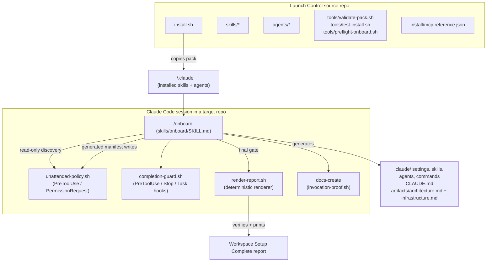

# Launch Control — Architecture

> **Generated snapshot** — 2026-08-07. Evidence: `README.md`, `install.sh`,
> `skills/onboard/SKILL.md`, `skills/onboard/references/*`, `skills/onboard/scripts/*`,
> `install/mcp.reference.json`, `tools/validate-pack.sh`, `tools/test-install.sh`. This is
> a point-in-time snapshot, not a permanently current source — re-run `docs-update` after
> material repository changes.

## Overview

Launch Control is a Claude Code-first onboarding and delivery kit, distributed as a portable
pack of Bash scripts and Markdown skill/agent/command definitions. Its `/onboard` command
scans an arbitrary target repository and generates a tailored, project-local `.claude/`
workspace: narrow settings, core skills, specialist agents, slash commands, a
project-specific `launch` delivery skill, and architecture/infrastructure snapshots. It
targets engineers who use Claude Code and want a repository equipped with accurate,
validation-aware guidance. Everything runs locally inside a Claude Code session; there is
no server, hosted service, or long-running process.

## Technology Decisions

| Decision | Choice | Rationale |
|---|---|---|
| Implementation | Bash + Markdown | Portable across machines with no application runtime or build step. Skills, agents, and commands are Markdown consumed directly by Claude Code. |
| Distribution | `install.sh` copies the pack into `${CLAUDE_CONFIG_DIR:-$HOME/.claude}` | Digest-guarded, idempotent installs; unknown or user-modified copies stop before mutation. |
| Deterministic completion | `skills/onboard/scripts/render-report.sh` renderer + `skills/onboard/scripts/completion-guard.sh` Stop/PreToolUse hooks | `/onboard` success is only valid when the renderer exits zero and the final message equals its stdout byte-for-byte. The renderer verifies the workspace and records the project's documented gates; it never runs a project command. |
| Least-privilege discovery/writes | `skills/onboard/scripts/unattended-policy.sh` (PreToolUse + PermissionRequest) | Auto-allows only repo-local read-only discovery, and the exact generated manifest paths; everything else, including any project command, keeps its normal prompt (a hard deny under bypass). |
| Validation | `tools/validate-pack.sh` + `./install.sh --dry-run` | A single declared contract; no gates are inferred from installed tools or file types. |
| Required dependency | Superpowers plugin; plus `bash`, `git`, `jq`, `rg` on PATH | Generated `launch` invokes `superpowers:*` skills; the hooks require `jq`. `install.sh` owns provisioning. |

## System Architecture

There are no network ports or wire protocols. The "interfaces" are hook JSON on stdin/stdout
(Claude Code hook contract), CLI flags to `install.sh`/`tools/*.sh`, and Git metadata files
under `$GIT_DIR` used to pass proof/baseline state between hooks and the renderer.

## Component Deep Dives

### `install.sh`
Installs the pack into `${CLAUDE_CONFIG_DIR:-$HOME/.claude}`. Digest-guarded and idempotent:
untouched older Launch Control copies are backed up and upgraded; unknown or user-modified copies
stop the install before any dependency or file mutation. Flags: `--dry-run`, `--force`,
`--optional-tools`, `--uninstall`.

### `skills/onboard/` (the `/onboard` command)
`SKILL.md` defines the multi-phase onboarding contract; its frontmatter wires four hook
events to two scripts:
- `unattended-policy.sh` — the skill-scoped, non-persistent permission policy. Auto-allows
  repo-local read-only discovery, writes to the fixed generated manifest, approved read-only
  Git/plugin checks, and the installed renderer. Project commands are never auto-allowed. Denies
  shell composition, repository mutation, and out-of-repo access — including path arguments
  to Bash readers (`cat`/`ls`/`head`/`tail`/`wc`/`grep`/`rg`), validated repo-relative with
  shell-metacharacter arguments (globs, `~`/`$` expansion, escapes) denied so the literal
  path is what is checked. Composition parsing is quote-aware: a literal `|` inside a
  balanced single- or double-quoted regex is allowed, while a real pipe, redirection, or
  substitution remains denied. Arbitrary root and nested `.env*` variants are protected;
  only exact `.env.example`, `.env.sample`, `.env.template`, and `.env.local.example`
  basenames are safe discovery inputs. Unlisted operations prompt normally and hard-deny under `bypassPermissions`,
  where no prompt can appear.
- `completion-guard.sh` — the lifecycle boundary. On the first `Edit`/`Write` it captures the
  dirty-path baseline plus a type/hash/executable-state inventory of every active manifest
  path into Git metadata; on `Stop` it blocks any run that wrote files or
  claimed success until `render-report.sh` produced fresh proof and the final message equals
  it byte-for-byte. `TaskCreated`/`TaskCompleted` track UI tasks. A **discovery-emission
  gate** (`discovery_emission_missing()`) additionally denies project writes until the
  Workspace Discovery Report is visible in the transcript — either as a standalone assistant
  message or inside any tool_result (the discovery-checkpoint script re-emits the report on
  stdout, so the organic flow satisfies the gate in every model mode). A per-session circuit
  breaker (`.emission-denies` counter) stands the write gate down after two denies so a
  model mode that cannot satisfy it never livelocks; the `Stop` backstop still blocks a
  no-proof completion independently. Verified completion removes
  active, baseline, task, report-proof, bootstrap-proof, permission-mode, and deny-counter
  markers and `.launch-control-onboard/` state,
  then writes a session-keyed `.disarmed` marker. That marker makes retained skill hooks a
  no-op for unrelated same-session work; a later `/onboard` prompt removes it and re-arms the
  lifecycle before discovery. Two **write-time content gates**, the `inspector` lens
  shape and generated-guidance rules, decide at write time what
  the renderer would otherwise reject minutes later at the terminal operation. Each judges
  the content the write would *leave on disk*, resolved by `resolved_write_content()`, so an
  `Edit` or `MultiEdit` is judged exactly as a `Write` is; an unresolvable payload returns
  non-zero and the caller stands down rather than guessing. The renderer keeps its own copy
  of every check — this hook is advisory infrastructure a degraded session may skip, and only
  the renderer is unbypassable.
- `discovery-checkpoint.sh` — the Phase 0 attestation point. Validates the written
  discovery report against a required schema, records a hash-stamped checkpoint marker, and
  re-emits the report on stdout so the emission gate is satisfied by its tool_result. When
  `AGENTS.md` contains an onboard-generated marker block it appends a
  `STALE-AGENTS-CANDIDATE` advisory instructing the model to read and judge the block
  (`AGENTS.md` is user-authoritative — the model never writes it; in Codex mode the
  finalizer mirrors only the generated block).

### `skills/onboard/scripts/render-report.sh`
The deterministic completion renderer. Validates the ledger (four statuses, one per path),
required/baseline paths, task closure, docs-create proof, and the content of generated
docs and the `inspector` agent. The ledger the model writes contains **only manifest
paths**; the renderer derives the `Untouched pre-existing` report section itself from the
Phase 0 baseline captures (`derive_baseline_preserved_rows()`) and content-verifies those
rows, so non-manifest dirty files are never hand-classified. Outside Codex mode, when
`AGENTS.md` carries an onboard-generated marker block, the rendered report includes a machine-emitted
`Stale AGENTS.md` section and lists manual regeneration under `Next:` instead of `none` —
the staleness finding never depends on model prose. It stores its exact stdout under Git
metadata for the Stop hook and prints the `=== Workspace Setup Complete ===` report.

### `skills/docs-create/`
Generates `artifacts/architecture.md` and `artifacts/infrastructure.md`. Its
`scripts/invocation-proof.sh` PreToolUse hook records, per session, which artifact paths it
wrote — the onboard renderer refuses to report success for a newly created doc without that
proof.

### Pipeline skills and agents (`skills/*`, `agents/*`)
The pack ships 17 skills: `onboard`, `offboard`, `launch-ticket`, `launch-backlog`, the
CRISPY ladder (`research-questions`, `research-codebase`, `design-doc`, `design-outline`,
`plan-write`, `plan-execute`, `review-doc`), `docs-create`, `docs-update`, `catalog`,
`log-decision`, `logbook`, and the internal `snippets-shared-by-skills`. `catalog` writes
guide stars (short, sourced domain facts) to `guide-stars/`, and the seven CRISPY skills read
them through `snippets-shared-by-skills/guide-stars-preamble.md`. `log-decision` records a
decision under `workbench/<TICKET>/decision/`; `logbook` is a read-only list of those
decisions, newest first. The pack agents these skills dispatch are `surveyor`, `navigator`,
and `veteran` (locate, explain, and find patterns in code), `technician` and `integrator`
(locate and synthesize prior workbench artifacts), and `skeptic` and `editor` (substance and
readability review). These are installed globally and are the durable delivery workflow.
Session checkpoint skills are not part of the pack; `/onboard` generates project-local
`checkpoint-*` skills instead.

### `tools/`
`validate-pack.sh` (the pack validator: shell syntax, reference JSON, template balance,
onboarding contracts, renderer/guard behavior), `test-install.sh` (fixture-driven installer
checks), `preflight-onboard.sh` (source/install parity check before a manual acceptance test),
`launch-control-digests.sh` (ownership digest helper), `mutation-run.sh` (mutation harness — seeds
a defect and asserts the validator dies on it; restores the tree on exit). The validator body
is split into ordered parts under `tools/validate/`, **sourced in sequence and building on
each other's fixtures**, so a part cannot be run standalone without its predecessors.

## Data Model

Launch Control has **no persistent database or message schema** — it is a stateless generator.
Its load-bearing "data structures" are ephemeral files exchanged between hooks and the
renderer under the repository's Git metadata directory:

| Artifact | Shape | Purpose |
|---|---|---|
| `launch-control-onboard-run-<session>.active` | marker file | Signals an in-progress onboarding run for this session. |
| `launch-control-onboard-run-<session>.baseline` | newline-delimited relative paths | Pre-write dirty worktree paths captured on first `Edit`/`Write`; every one must be `PRESERVED`. |
| `launch-control-onboard-run-<session>.inventory` | tab-separated scope, path, pre-run type, `git hash-object --no-filters` hash, and executable bit | Proves `CREATED`, `MERGED`, `PRESERVED`, and `SKIPPED` against the active manifest and dirty baseline. |
| `launch-control-onboard-run-<session>.mode` | `default` or `launch-control` | Selects the exact manifest whose paths must each receive one honest ledger status; recreated by same-session re-arm. |
| `launch-control-onboard-run-<session>.tasks` | newline-delimited task IDs | Open UI tasks; must be empty before the renderer runs. |
| `launch-control-onboard-run-<session>.discovery` | marker file | Records that the discovery checkpoint script ran for this session; consumed by the emission gate and re-arm logic. |
| `launch-control-onboard-run-<session>.emission-denies` | single integer | Discovery-emission write-gate deny counter; at 2 the gate stands down (Stop backstop unaffected). |
| `launch-control-onboard-run-<session>.rendered` | marker file | Records that the renderer was invoked for this session's lifecycle accounting. |
| `launch-control-onboard-report.expected` | exact renderer stdout | Fresh byte-for-byte proof consumed by the Stop hook; removed after verified completion. |
| `launch-control-onboard-run-<session>.disarmed` | marker file | Disables retained onboard hooks after success in the same session; removed by the next `/onboard` prompt. |
| `launch-control-bootstrap-docs-<session>.proof` | newline-delimited doc paths | Which artifact docs `docs-create` wrote this session. |
| `.launch-control-onboard/` control files | tab-separated `STATUS\tPATH` ledger (`CREATED`/`MERGED`/`SKIPPED`/`PRESERVED`, manifest paths only) + required/baseline path lists + `discovery-report.txt` + hash-stamped `discovery-checkpoint` marker | The completion ledger and Phase 0 attestation the renderer and hooks validate. |
| `install/mcp.reference.json` | JSON `mcpServers` map | Secret-free reference MCP catalog (see Integrations). |

Successful completion removes every temporary proof/control artifact above except the
session-keyed `.disarmed` marker. A later same-session `/onboard` removes that marker and
recreates fresh mode/baseline/inventory state on the first write. Failed or blocked runs
do not disarm the hooks.

## Integrations (MCP)

Launch Control ships a **secret-free reference catalog** at `install/mcp.reference.json`; a normal
`/onboard` run reports MCP opportunities but writes no project `.mcp.json` unless `--enable-mcp`
is passed. The catalog mixes two transport classes and must not be described with a blanket
authentication claim:

- **`github` and `atlassian` are authenticated remote MCP integrations** (`type` + `url`
  entries — HTTP/SSE). Complete their user authentication through Claude Code `/mcp`.
- **`shadcn` and `chrome-devtools` are local stdio servers** (`command` + `args`, launched with
  `npx`). They are local stdio processes and use no remote OAuth; do not tell users to
  authenticate them through `/mcp`.

## Generated layout vs. downstream artifacts

`/onboard` creates only the paths in its declared manifest (`.claude/` settings/skills/agents/
commands, `CLAUDE.md`, and these `artifacts/*` docs). It **does not create `workbench/`**. The
CRISPY skills create `workbench/<TICKET>/<stage>/` artifacts later during delivery. Keep that
boundary explicit: `workbench/` is never part of the onboarding-generated target layout.

The onboard completion guard is declared in `skills/onboard/SKILL.md` frontmatter and is active
only while that skill runs; it is not registered in `~/.claude` config, installed config, or
generated project settings. The optional branch-protection/skill-eval hooks are a separate
`--enable-hooks` overlay.
